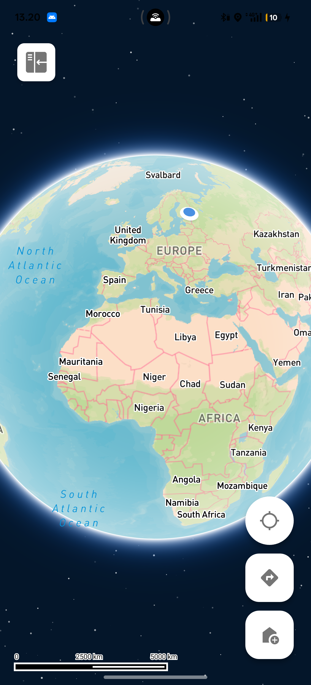

# Ahtet

[](https://github.com/itzreggie/FullStack_project/actions/workflows/flutter.yml)
[](https://github.com/itzreggie/FullStack_project/actions/workflows/backend.yml)

Ahtet is a mobile app that helps children and young people with cognitive
disabilities, including autism, travel and handle daily routines with more
independence. Parents or trusted caregivers can follow the child's location
on a map and get notified when the child enters or leaves a safe zone.



## Features

- **Accounts.** Users sign up and sign in with email and password. Every
  device, safe zone, route and task belongs to the signed in user.
- **Live map.** A Mapbox map whose style follows the time of day. The user
  and every connected device show up as round photo markers with a pulse.
- **Location tracking.** The phone's position is sent to Supabase, also in
  the background, and can be turned on or off in the settings.
- **Connected devices.** Each phone gets a short code such as `12A-B34`. A
  parent types in a child's code to follow that phone on the map and can
  give it a custom name.
- **Safe zones.** Search for a place, save it as a safe zone and draw its
  border on the map by dragging four corners.
- **Notifications.** A notification is shown when a connected device enters
  or leaves a safe zone. Every event is saved and can be reviewed in the
  notification history.
- **Routes.** Plan a route between two places by walking, driving or
  cycling, choose a time range and save it. Saved routes can be shown on
  the map again.
- **Tasks.** Create daily, weekly or one time tasks with an optional photo
  and tick them off on the home screen.
- **Privacy and contact pages.** The sidebar explains what data the app
  keeps and how to get in touch.

## Tech stack

| Part | Technology |
| --- | --- |
| Mobile app | Flutter and Dart (Dart SDK 3.8 or newer) |
| Backend server | Node.js with Express |
| Database | Supabase (PostgreSQL), with Auth, Realtime and Storage |
| Maps and places | Mapbox, Google Places and Google Directions |

## How the parts work together

The app talks to Supabase directly for reading data and for simple writes
such as routes and tasks. Row level security policies in the database make
sure a user only sees their own rows and the devices they are connected to.

Actions that need extra checks go through the Express backend: connecting
to another device by its code, renaming or removing a connection, and
creating or deleting safe zones and their borders. The app sends the
user's Supabase access token with each request, and the backend runs the
queries as that user, so the same policies apply.

## Backend API

All `/api` routes need an `Authorization: Bearer <access token>` header.

| Method | Path | What it does |
| --- | --- | --- |
| GET | `/health` | Checks that the server is running |
| POST | `/api/devices/connect` | Connects the user's device to another device by its code |
| PATCH | `/api/devices/connections/:id` | Sets or clears the name of a connection |
| DELETE | `/api/devices/connections/:id` | Removes a connection |
| POST | `/api/safe-zones` | Creates a safe zone |
| DELETE | `/api/safe-zones/:id` | Deletes a safe zone and its border |
| PUT | `/api/safe-zones/:id/bounding-box` | Creates or updates the four corner border of a safe zone |

Errors come back as JSON in the form `{ "error": "message" }`, with 400 for
bad input, 401 for a missing or expired token and 404 when a row does not
exist or belongs to someone else.

## Libraries used in the app

| Package | Version | What it is used for |
| --- | --- | --- |
| `mapbox_maps_flutter` | ^2.8.0 | The map, custom day and night styles, markers, safe zone polygons and route dots |
| `geolocator` | ^14.0.0 | Location permission, the current position and the position stream |
| `flutter_background_service` | ^5.1.0 | Sending the position to Supabase while the app is closed |
| `supabase_flutter` | ^2.1.0 | Sign in, reading and writing app data, Realtime updates for device positions and uploading task photos |
| `flutter_local_notifications` | ^19.2.1 | Safe zone entry and exit alerts and the background tracking notice |
| `flutter_dotenv` | ^5.2.1 | Loading the API keys and the backend address from `.env` |
| `http` | ^1.1.0 | Calls to the backend, Mapbox geocoding, Google Places and Google Directions |
| `device_info_plus` | ^9.1.1 | The device name and hardware id |
| `shared_preferences` | ^2.2.2 | Keeping the generated device code and device info on the phone |
| `image_picker` | ^1.1.2 | Taking or choosing a photo for a task |
| `intl` | ^0.19.0 | Formatting the time of each event in the notification history |

## Libraries used in the backend

| Package | Version | What it is used for |
| --- | --- | --- |
| `express` | ^4.18.2 | The HTTP server, the routes and the error handling |
| `cors` | ^2.8.5 | Allowing requests from other origins |
| `dotenv` | ^16.3.1 | Loading the Supabase keys from `supabase/.env` |
| `@supabase/supabase-js` | ^2.39.0 | Checking access tokens, running queries as the user and the admin client for migrations and device code lookups |
| `nodemon` | ^3.0.2 | Restarting the server on changes during development (`npm run dev`) |

## External services

- **Mapbox:** map tiles, four custom map styles and geocoding (place search
  and reverse geocoding).
- **Google Places API:** a second source for place search results.
- **Google Directions API:** route options between two places.
- **Supabase:** email sign in, the PostgreSQL database with row level
  security, Realtime for live device positions, and the `task-images`
  Storage bucket where each user uploads into their own folder.

## Development tools

- Git and GitHub for version control
- `flutter_lints` (^5.0.0) and `flutter analyze` for static checks
- `flutter_test` for unit tests of the device code, the safe zone check and
  the search name matching
- npm for the backend packages and scripts

## Project structure

- `lib/main.dart` starts the services and shows the login screen or the map.
- `lib/screens/` holds the screens: login, sign up, map, home, directions,
  safe zones, task input, settings, notification history, privacy and
  contact.
- `lib/services/` holds the logic for auth, the backend API, Supabase,
  tracking, notifications, place search, routes and map markers.
- `lib/widgets/` holds the reusable parts such as the map buttons, the
  sidebar, the bounding box editor and the lists.
- `lib/assets/` holds the images and app icons.
- `test/` holds the Flutter tests.
- `supabase/` holds the backend:
  - `index.js` and `app.js` start the Express server and set up the routes.
  - `middleware/` checks access tokens and logs requests.
  - `routes/` has the device and safe zone endpoints.
  - `lib/validate.js` checks request bodies.
  - `supabase/migrations/` has the numbered SQL files for tables and
    policies, and `scripts/migrate.js` runs them in order.

## Running the app

1. Install the [Flutter SDK](https://docs.flutter.dev/get-started/install)
   (Dart 3.8 or newer).
2. Clone the repository:

   ```
   git clone https://github.com/itzreggie/FullStack_project.git
   cd FullStack_project
   ```

3. Copy `.env.example` to `.env` in the project root and fill in the keys:

   - `MAPBOX_ACCESS_TOKEN` from your Mapbox account
   - `GOOGLE_PLACES_API_KEY` from Google Cloud
   - `SUPABASE_URL` and `SUPABASE_ANON_KEY` from your Supabase project settings
   - `BACKEND_URL`, the address of the Express server, for example
     `http://10.0.2.2:3000` when the server runs on the same computer as an
     Android emulator

   The app bundles `.env` as an asset, so the file has to exist before you
   build. It is listed in `.gitignore` to keep the keys out of the repository.

4. Get the packages and start the app on a connected device or emulator:

   ```
   flutter pub get
   flutter run
   ```

5. Run the tests with:

   ```
   flutter test
   ```

## Running the backend

1. Install [Node.js](https://nodejs.org/).
2. Copy `supabase/.env.example` to `supabase/.env` and fill in the keys from
   your Supabase project settings.
3. Install the packages and start the server:

   ```
   cd supabase
   npm install
   npm start
   ```

4. Open http://localhost:3000/health to check that the server is running.
5. Create the tables, policies and the `task-images` storage bucket with:

   ```
   npm run migrate
   ```

   The script runs every file in `supabase/migrations/` that has not been
   applied yet and records it in a `schema_migrations` table. It calls an
   `execute_sql` function, which has to exist in your Supabase project.

## Author

Rejoice Ekong
